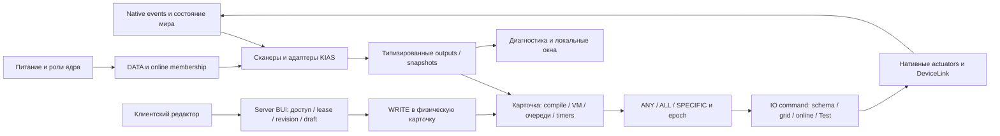

# KIAS — независимое ревью архитектуры, корректности и минимальности

> Исторический аудит исходного HEAD `5635bd2c`: ссылки на проверявшиеся исходники ведут в неизменяемый `baseline-source/`. Текущие исправления и результаты проверок описаны в [07_FIXES_AND_VALIDATION.md](<D:/Workspace/ss14_lua/corvax/Monolith/KIAS_REVIEW/07_FIXES_AND_VALIDATION.md>).

## Вывод для владельца

**Текущую ветку не рекомендую сливать без исправления диагностического режима, lifecycle дефектов и очистки внешней поставки.** Переписывать систему с нуля оснований нет. В KIAS есть рабочая ограниченная графовая VM, физические карточки, осмысленное разделение DATA и рабочего питания, полноценные нативные эффекты и содержательные integration tests. Основной риск находится на границах этих частей: потеря доступности отдельного устройства, сохранение state при rebuild, отложенная диагностическая работа и глобальные очереди нескольких кораблей.

Выделено **12 замечаний: P1 — 1, P2 — 10, P3 — 1**. Четыре ошибки независимо воспроизведены новыми тестами; дополнительные структурные факты и уверенные выводы по коду обозначены отдельно. P0 не обнаружены. Прохождение штатных 167 тестов не отменяет новых воспроизведений.

Самое срочное: сервисный Test генерирует реальный импульс; timer на 6 секунд выполняет настоящую команду после завершения пятисекундного Test. Затем исправить отключение optical camera, потерю outputs при no-op rebuild и задержку готового корабля из-за dirty очереди другого. Кэш Room selectors, power deficit и fire alarm также требуют направленных регрессий.

## Снимок и правила сравнения

| Параметр | Проверенное значение |
|---|---|
| Рабочий каталог | D:/Workspace/ss14_lua/corvax/Monolith |
| Ветка / HEAD | KIAS / `5635bd2c4d1d5ba183700a535f07cfa340cd98ad` |
| upstream/main при первом снимке | `08c9589ddfe4c5eb5ed9668f134693696c38402d` |
| upstream/main при повторной проверке | `cc7a94472a1695e3340f94178d46970cf950da79` |
| Merge-base HEAD с обоими снимками main | `3226889714d52cad147566c623dd7f18debd21ed` |
| origin/main | `3226889714d52cad147566c623dd7f18debd21ed` |
| RobustToolbox | `c2fc1375fc8647f4a29d2e9c8a8ae86dfb35d66e`, чистый checkout |
| Базовый gitlink | `96c6bddcebab253182a0e0eeec8e39d6a87e8264` |

В ходе ревью main продвинулся; HEAD KIAS и merge-base не изменились. Diff инвентаризирован локальным git целиком, не по последнему commit и не по обрезанному GitHub списку. Fetch/commit/push/merge/rebase/reset/submodule update не выполнялись. Remote ref проверялся read-only. Финальный status: только `?? KIAS_REVIEW/`; tracked исходники и submodule чистые. Снимок сохранён в `final-repo-snapshot.json`.

| Раздел diff | Файлов |
|---|---:|
| Собственный production: Server / Shared / Client | 81 = 44 / 25 / 12 |
| KIAS integration tests | 51 |
| Benchmark tools | 87 |
| Собственные ресурсы | 201 |
| Docs/KIAS | 30 |
| Вне собственных каталогов KIAS по буквальному пути | 122 |
| Всего | **572** |

Собственный production просмотрен полностью. Матрица 06 отдельно показывает межсистемную проверку, конкретные воспроизведения, тестовые assertions, статический ресурсный аудит и пределы просмотра вспомогательных файлов. `READ` не означает line coverage, `VERIFIED` не означает отсутствие любых будущих ошибок. Неподтверждённые гипотезы не включены в число подтверждённых игровых дефектов.

## Реальная архитектура

**Topology и lifecycle.** KiasSystem ведёт grid-local registry, ядро, роли, DATA graph, dirty/rebuild, online status и события доступности. Корабельные устройства обнаруживаются по anchor/grid; CableVisuals — отдельное отображение соседей. KiasTransformSystem и grid removal связывают изменения координат с invalidation. Duplicate core и отсутствие питания обрабатываются явно. Само наличие устройства не должно активировать обычный прибор на карте без работающего core.

**Комнаты.** RoomGeometry/RoomTopology разделяют geometric snapshot и запросы сканера. Есть ограничение размеров, directional edges, door terminals, interior/exterior и grid-local координаты. Over-limit не выдаётся за частично корректное покрытие. Это содержательная подсистема, а не необязательная обёртка над radius query. Identity room grouping обслуживает отображение; его возможное расхождение с authoritative scanner geometry требует целевого случая, не автоматического удаления.

**Интеграция.** Scanner handoff и Direct binding согласуются отдельно от functional power. Интегрированная лампа после OFF должна оставаться управляемой, иначе ON невозможен. Смешивать эту доступность с `Powered` нельзя. Частые CanControl/reconcile — кандидат измерения, но кеш без DATA/role/grid invalidation создаст опасную регрессию.

**Контроллеры.** Shared содержит typed ports, enum domains, serializable program, compiler и state machine; server — физические слоты, rack power, queues, subscriptions, epoch и IO. Ограничения compiler: 128 nodes, 256 wires, 32 external nodes и fan-out 32; finite/range validation и ограниченные строки. Очереди, feedback fault и topology guards полезны, но глобальный `break` нарушает независимость задержек гридов. Program version, nullable bindings и snapshot native Link schema позволяют перенос карточки без подмены неизвестного профиля выдуманным типом.

**Сенсоры.** Crew/registration, threat/fauna, radiation/anomaly, hull/impact, navigation/IFF/FTL и power имеют разные источники истины. Расписания и cooldowns не следует объединять ради меньшего числа файлов. Crew выполняет повторные проходы по миру/экипажу; необходимость каждой проверки доступа важна, но можно измерить reuse внутри одного стабильного прохода.

**Эффекты.** Освещение, пожаротушение с реальным cartridge/foam, native ventilation, AME, jammer, FireControl, gun cancellation, navigation, speech/radio и recorder проходят через конкретные владельцы native state. Много небольших adapter-систем здесь оправдано различными событиями и правилами. Наличие публичного setter само по себе не является плохим coupling; прямые ссылки native core systems на KIAS policy требуют минимизации.

**UI и доступ.** Server проверяет ownership/deed/company/POI, физическую доступность, draft lease, revision, принадлежность binding гриду и схему команды. Клиентский граф не является авторитетным. Frozen-map edit допускается только для mapping admin на paused, uninitialized map; обычная пауза не включает работу без питания. Layout/headless tests полезны, но не заменяют ручное управление окнами. Известные проблемы — неполная палитра после 256 device/profile rows, Room invalidation и лишний Refresh.

## Что сделано хорошо и следует сохранить

- Физическая карточка и атомарный WRITE отделены от editor draft; stale revisions и чужие bindings проверяются на сервере.
- Native APIs используются для большинства эффектов, сохраняя заряд/боезапас/питание/контейнеры и фактическое изменение мира.
- Compiler ограничивает размер и типы графа; неисправная feedback-карта может fault локально, не останавливая независимую карточку.
- Есть lifecycle/epoch, hard-off, no-data, shutdown, persistence, native light OFF→ON, damage/healing, harmless/hostile и explicit negative controls.
- Телеметрия различает inclusive/exclusive, queue age и accepted dispatch; режим без измерений имеет отдельную проверку. Большая лаборатория в основном условная, не встроена целиком в production hot path.
- Прототипы, физические модули, рецепты и enum labels проверены integration-тестами с настоящими клиентскими/серверными системами. RSI проверены структурно; это не ручная визуальная приёмка в игре.

## Изоляция от проекта и движка

122 внешних файла содержат 30919 изменённых текстовых строк (+ и −), включая 24762 строки лабораторной карты. Это не 30919 строк вмешательства в native C#. 47 файлов относятся к Content/csproj/чужим прототипам; в 34 рекомендуется сохранить обоснованную узкую поверхность KEEP/MINIMIZE (текущие 318 строк), остальные доставлять отдельно либо заменить API. Число 34 не означает, что все их текущие строки необходимы в нынешнем виде.

Решения по каждому файлу: KEEP 25, MINIMIZE 16, MOVE_TO_KIAS 53, REVERT 14, REPLACE_WITH_NATIVE_API 2, INDEPENDENT_UPSTREAM_FIX 12. Потенциально исключить из внешней KIAS-поставки/перенести можно 81 файл; это не разрешение удалить 81 файл без исправления ссылок. У 34 оставляемых native файлов отсутствуют обязательные KIAS START/END блоки.

GunSystem и DamageableSystem имеют уже достаточные native события. Напротив, CableNode не имеет общего выключателя связности, Atmos query читает ограниченные внутренние tiles, а ProjectileHitEvent предшествует фактическому damage; там нужный контракт нельзя заменить похожим названием метода. Нейтральные узкие hooks разумнее копирования сложной native логики внутрь KIAS.

RobustToolbox delta — только CVars/NetManager, 80 добавлений и 10 удалений для окна ошибок дешифрования. **Необходимых engine-изменений для KIAS не найдено.** Этот patch не является Physics оптимизацией и должен рассматриваться отдельно. В аудите gitlink не менялся.

Root README подменён заданием агенту. Документы разных этапов и родительские Station AI/radio fixes попали в общий diff; текущее Docs/KIAS/PULL_REQUEST.md описывает лишь старый этап и не подходит как описание всей ветки. Отделить постановочные пакеты от документации продукта и сохранить используемые lab.py пути при переносе.

## Производительность

Готовая серия A–B–B–A пересчитана независимо: pooled mean **5.5722 → 7.7454 ms**, median **3.7352 → 4.2664 ms**, P99 **19.1915 → 56.3722 ms**. Разница со старыми 19.29/56.45 — pooled quantile против среднего двух quantiles. В B выше и доля тиков >16.67 ms: 3.223% против 1.179%.

Из +2.1732 ms mean delta около +1.3151 ms относится к content+engine, +0.2782 ms к driver и +0.5573 ms к observer. Physics +0.1858 ms вложен в content; его нельзя прибавлять второй раз. Само место Physics в рейтинге не обосновывает engine patch.

Accepted command P99 — 69–70 ticks, максимум 74–77; это IO dispatch, не физический effect completion. В конце B 1040 live machines и пустые очереди, но это не отменяет задержек. Локальные кандидаты: fairness, повторные CanControl/reconcile, scans людей по grids, geometry allocations и double UI refresh. Для предложений нет выдуманных процентов ускорения; стоимость, invalidation и проверка приведены в отчёте 04.

Проверено происхождение результата: архивный HEAD 00a6e937 дополнен рабочим patch, 231 fingerprint файла и 37 patch postimages совпадают с текущим HEAD. Нельзя ни без проверки приписать старый архив новым изменениям, ни объявить его нерелевантным по одному SHA. A — matched baseline с общими fixes и тем же engine, не чистый нынешний main. `strictReady=false` и `fullGameplayCoverage=false` остаются в силе.

Дополнительно обнаружен KIAS-12: requested rotation теряется при чтении JSON, поэтому `collision_rotated` не проверяет заданные углы. Отдельные room pose integration tests от этого не становятся неверными; полную rotated collision сертификацию надо исправить.

## Проверки текущего checkout

| Проверка | Результат | Что доказывает |
|---|---|---|
| Полный Release KIAS integration filter | **167 passed, 0 failed, 0 skipped**, 11m36s | Существующие assertions текущих 51 файлов/parameterized cases |
| Новые read-only evidence tests | **4 passed**, 4m7s | Наличие четырёх описанных дефектов; не правильность поведения |
| Python benchmark unit tests | **107 passed**, 32.923s | Проверенные модели/report/proof functions; не все реальные сценарии |
| RU/EN locale keys | **864 / 864**, нет duplicate/missing key между языками | Структурная парность; не качество перевода каждого текста |
| RSI inspection | **65 RSI / 128 states** | Размеры/manifest/frames; два blank.png намеренно прозрачные layers |
| Полный source inventory и external/engine diff | 572 / 122 / 2 файла | Поверхность изменения от merge-base, а не последнего commit |
| ZIP raw-data/source provenance | Пересчитано и сопоставлено | Ограниченная достоверность указанной ABBA, не gameplay readiness |

Сборка integration-проекта прошла с предупреждениями. Отдельный новый buildAllRelease и ручной graphical smoke в этом аудите не выполнялись; старые логи из Docs не выданы за свежие результаты. Игровые окна и изображения пользовательского клиента не управлялись. Существующие benchmark артефакты не перезаписаны, START не отправлялся.

## Готовность к PR и порядок действий

Первый будущий patch — diagnostic isolation и lifecycle/state corrections. Затем fairness и регрессии кэшей. Отдельно — минимизация native bridges, маркировка и упаковка diff. После correctness можно измерять локальные оптимизации. Даже после этого для заявления о полной готовности нужны оставшиеся native/manual contracts, перечисленные в матрице 06; status COMPLETE старой серии этого не заменяет.

Не предлагается сливать всё в один переписывающий commit, менять Physics ради рейтинга или объединять рабочие адаптеры ради числа классов. Предлагаемые действия сохраняют текущую модель и уменьшают её уязвимые межсистемные границы.

## Документы и доказательства

- [02_FINDINGS.md](<D:/Workspace/ss14_lua/corvax/Monolith/KIAS_REVIEW/02_FINDINGS.md>) — причины, сценарии, строки, минимальные правки и уровень уверенности.
- [03_EXTERNAL_CHANGES_AUDIT.md](<D:/Workspace/ss14_lua/corvax/Monolith/KIAS_REVIEW/03_EXTERNAL_CHANGES_AUDIT.md>) — все 122 внешних файла, альтернативы и маркировка.
- [04_PERFORMANCE_REVIEW.md](<D:/Workspace/ss14_lua/corvax/Monolith/KIAS_REVIEW/04_PERFORMANCE_REVIEW.md>) — пересчёт и причинные границы performance выводов.
- [05_MINIMAL_PATCH_PLAN.md](<D:/Workspace/ss14_lua/corvax/Monolith/KIAS_REVIEW/05_MINIMAL_PATCH_PLAN.md>) — порядок будущих patches и предлагаемые Forge blocks.
- [06_COVERAGE_AND_TEST_GAPS.md](<D:/Workspace/ss14_lua/corvax/Monolith/KIAS_REVIEW/06_COVERAGE_AND_TEST_GAPS.md>) — матрица файлов, проверенные контракты и реальные пробелы.
- [inventory.csv](<D:/Workspace/ss14_lua/corvax/Monolith/KIAS_REVIEW/inventory.csv>), [integration-tests.log](<D:/Workspace/ss14_lua/corvax/Monolith/KIAS_REVIEW/integration-tests.log>), [evidence-tests.log](<D:/Workspace/ss14_lua/corvax/Monolith/KIAS_REVIEW/evidence-tests.log>), [ABBA_RECOMPUTED.json](<D:/Workspace/ss14_lua/corvax/Monolith/KIAS_REVIEW/ABBA_RECOMPUTED.json>) — воспроизводимые первичные данные текущего аудита.
